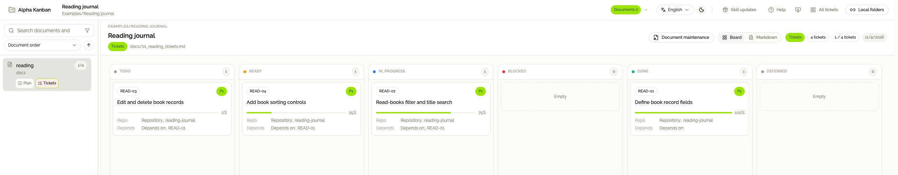

<p align="center">
  
</p>
<h1 align="center">Alpha Kanban</h1>
<p align="center"><strong>Keep your plans with AI in Markdown. Pick up where you left off.</strong></p>
<p align="center"><a href="README.md">한국어</a> · English</p>
<p align="center">
  <a href="#get-started">Get started</a> ·
  <a href="https://kanban.giveit2.me/">Open Kanban</a> ·
  <a href="https://kanban.giveit2.me/docs">User guide</a> ·
  <a href="https://kanban.giveit2.me/releases">Release notes</a>
</p>

**Alpha Kanban keeps the plans, scope, and verification results you agree on with AI in your project.**
The [implementation-ledger skill](skills/implementation-ledger/SKILL.md) records them in Markdown, ready to read when you resume work. An optional web viewer turns those same files into a Kanban board.

<a href="docs/assets/readme/board-en-light.jpg">
<picture>
  <source media="(prefers-color-scheme: dark)" srcset="docs/assets/readme/board-en-dark.jpg">
  
</picture>
</a>
<p align="center"><sub>A fictional reading journal project · <a href="examples/reading-journal/en/01_reading_plan.md">Read the plan</a> · <a href="examples/reading-journal/en/01_reading_tickets.md">See the original Markdown</a></sub></p>

- **Keep decisions beyond the conversation.** Check what you agreed to build and how far it has progressed.
- **Keep work records with your code.** Read them in any Markdown editor and track changes with Git.
- **Use your AI chat on its own.** The web viewer is optional, there when you want to read documents or check progress visually.

## Get started

### 1. Ask your AI tool to install the skill

Send the request below to an AI coding tool that supports skills and can access your local files. Installation needs access to GitHub. You do not need to clone this repository or run a local web server.

<details>
<summary><strong>Show the installation request</strong></summary>

```text
Check this AI tool's skill installation procedure and install implementation-ledger from this GitHub path:

https://github.com/KOR-Believer/alpha-kanban/tree/master/skills/implementation-ledger

Resolve the source to a full commit before downloading.
Install the entire folder from that commit, including references, assets, scripts, agents, and licenses, not only SKILL.md.
Verify installed file hashes and report the chosen commit.
Find and use the personal skill location recognized by this AI tool.
If a skill with the same name is already installed, compare it and explain the changes first.
Back up the existing installation and preserve my customizations. Ask before overwriting it.
Report the installation location and whether this AI tool recognizes it. Do not change project documents or code.
Only after success, print the actual installed directory as copyable text in the final response.
Explain that registering this folder for confirmed web updates is optional:
https://kanban.giveit2.me/about#updates
Do not include my personal path in the URL.
```

</details>

After installation, check that your AI tool recognizes `implementation-ledger`. If it does not, ask it to check the installation path and its skill-loading procedure. [Full installation guide →](https://kanban.giveit2.me/docs/install)

### 2. Talk about what you want to build

No account or configuration files are needed to start.

```text
Use the implementation-ledger skill.
I want to build a reading journal app. Let's discuss the features and scope first.
Do not write documents or code yet.
```

### 3. Review the tickets, then ask for implementation

Once you have a direction, ask for a draft.

```text
Use implementation-ledger to draft tickets from what we agreed.
Add a plan if several tickets need shared design decisions.
Separate scope, acceptance criteria, and questions I need to decide. Do not implement yet.
```

Read the draft's features, exclusions, and acceptance criteria. Have your decisions reflected in the documents before requesting implementation.

```text
Implement the reviewed tickets in dependency order.
First read the latest user directions and relevant open questions.
Record verification results and remaining work in the tickets.
```

In your next conversation, ask AI to read the same tickets and continue.

## What stays in your project

| Document | What it records |
| --- | --- |
| [Tickets](examples/reading-journal/en/01_reading_tickets.md) | Scope, acceptance criteria, status, progress, user directions, and verification results |
| [Plan](examples/reading-journal/en/01_reading_plan.md) | Goals, design, and decisions shared by several tasks |
| Inventory | Research and evidence worth returning to |

Start with tickets. Add a plan or inventory when you need one. See the [document format](skills/implementation-ledger/references/ledger-format.md) for the full structure.

## View the same files as a board

[Open Kanban](https://kanban.giveit2.me/) → in desktop Chrome, choose **Open project** → select your project folder.

Review tickets by status, search their full text, and move between plans and tickets. **All tickets** brings work from several projects together. You can also change a status or leave a direction. Confirmed edits go back to the original Markdown; saving does not run AI.

Your documents stay in the local folder you choose. Alpha Kanban does not upload project Markdown. Folder connections and view preferences are stored in the current browser. [Web viewer guide →](https://kanban.giveit2.me/docs/progress)

## Update the skill

Send the [update request](https://kanban.giveit2.me/about#updates) to your AI tool to compare the installed skill with the official source, back it up, and update after your confirmation.

To manage updates on the web, open **Skill updates** and drop your installed `implementation-ledger` folder, or use **Choose folder**. Connecting does not change files. Review the differences and confirm to apply them after a full backup. Regular updates do not overwrite personal changes.

Finish AI tasks using the skill before updating or restoring it. [Connect and update](https://kanban.giveit2.me/docs/updates) · [Back up and restore](https://kanban.giveit2.me/docs/backup)

## Go further

| What you want to do | Guide |
| --- | --- |
| Use a document folder other than `docs` | [.ak.config settings](https://kanban.giveit2.me/docs/config) |
| Share context and organize documents by owner | [Owner folders and personal settings](https://kanban.giveit2.me/docs/owners) |
| Bring documents you maintain up to the current format | [Document maintenance](https://kanban.giveit2.me/docs/organize) |
| Move documents or hand work over | [Moving and handing off](https://kanban.giveit2.me/docs/handoff) |
| Open local links written on another PC | [Local folder connections](https://kanban.giveit2.me/docs/local-links) |
| Recover folder access or an app that will not open | [Folder permissions](https://kanban.giveit2.me/docs/folder-access) · [App repair](https://kanban.giveit2.me/repair.html) |

## Contribute

Found a rough edge or have an idea? [Open an issue](https://github.com/KOR-Believer/alpha-kanban/issues). To work on the skill or web app, see the [contribution guide](CONTRIBUTING.md) for local setup and checks.
