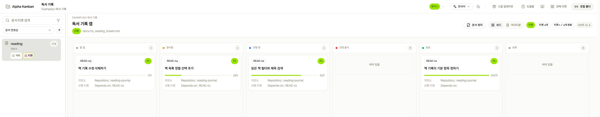

<p align="center">
  
</p>
<h1 align="center">Alpha Kanban</h1>
<p align="center"><strong>AI와 정한 일, Markdown으로 이어가세요.</strong></p>
<p align="center">한국어 · <a href="README.en.md">English</a></p>
<p align="center">
  <a href="#시작하기">시작하기</a> ·
  <a href="https://kanban.giveit2.me/">칸반 열기</a> ·
  <a href="https://kanban.giveit2.me/docs">사용 가이드</a> ·
  <a href="https://kanban.giveit2.me/releases">릴리즈 노트</a>
</p>

**Alpha Kanban은 AI와 합의한 계획, 작업 범위, 검증 결과를 프로젝트에 남기는 도구입니다.**
[implementation-ledger 스킬](skills/implementation-ledger/SKILL.md)이 Markdown으로 기록하고, 다음 작업에서는 그 문서를 읽고 이어갑니다. 필요하면 같은 파일을 웹에서 칸반으로 펼쳐볼 수 있습니다.

<a href="docs/assets/readme/board-ko-light.jpg">
<picture>
  <source media="(prefers-color-scheme: dark)" srcset="docs/assets/readme/board-ko-dark.jpg">
  
</picture>
</a>
<p align="center"><sub>가상의 독서 기록 앱 예제 · <a href="examples/reading-journal/ko/01_reading_plan.md">플랜 읽기</a> · <a href="examples/reading-journal/ko/01_reading_tickets.md">화면의 원본 Markdown 보기</a></sub></p>

- **대화가 길어져도 기준은 남습니다.** 무엇을 만들기로 했는지, 어디까지 끝났는지 문서에서 확인합니다.
- **작업 기록도 프로젝트의 일부입니다.** 평범한 Markdown 파일이므로 편집기로 읽고 Git으로 변경 이력을 관리할 수 있습니다.
- **AI 채팅만으로도 사용할 수 있습니다.** 웹은 문서를 읽고 진행 상황을 살펴보는 선택 사항입니다.

## 시작하기

### 1. 사용 중인 AI 도구에 스킬 설치 요청하기

로컬 파일을 다루고 스킬을 지원하는 AI 도구의 채팅에 아래 요청문을 보내세요. 설치에는 GitHub 연결이 필요합니다. 이 저장소를 복제하거나 로컬 웹 서버를 띄울 필요는 없습니다.

<details>
<summary><strong>설치 요청문 펼치기</strong></summary>

```text
이 AI 도구의 스킬 설치 방법을 확인하고 아래 GitHub 경로의 implementation-ledger 스킬을 설치해 줘.

https://github.com/KOR-Believer/alpha-kanban/tree/master/skills/implementation-ledger

내려받기 전에 원본을 전체 커밋 SHA로 고정해 줘.
SKILL.md뿐 아니라 references, assets, scripts, agents, licenses를 포함한 폴더 전체를 그 커밋에서 설치해 줘.
설치 파일 해시를 검증하고 선택한 커밋을 알려줘.
이 AI 도구가 인식하는 개인 스킬 경로를 확인해서 사용해 줘.
같은 이름의 스킬이 이미 있으면 먼저 비교해서 변경 내용을 알려줘.
기존 설치본은 백업하고 개인 수정은 보존해. 덮어쓰기 전에는 내 확인을 받아.
설치가 끝나면 설치 위치와 인식 여부를 알려줘. 프로젝트 문서나 코드는 변경하지 마.
성공한 경우에만 마지막 응답에 실제 설치 디렉터리를 복사 가능한 텍스트로 알려줘.
웹에서 업데이트를 관리하고 싶으면 그 폴더를 선택적으로 등록할 수 있다고 안내해 줘:
https://kanban.giveit2.me/about#updates
개인 경로는 URL에 포함하지 마.
```

</details>

설치가 끝나면 AI 도구가 `implementation-ledger`를 인식하는지 확인하세요. 보이지 않으면 설치 위치와 스킬 불러오기 방법을 확인해 달라고 요청하세요. [자세한 설치 안내 →](https://kanban.giveit2.me/docs/install)

### 2. 만들고 싶은 것부터 이야기하기

계정이나 설정 파일 없이 시작할 수 있습니다.

```text
implementation-ledger 스킬을 사용해 줘.
독서 기록 앱을 만들고 싶은데, 먼저 기능과 범위를 같이 논의하자.
아직 문서나 코드는 작성하지 마.
```

### 3. 티켓을 읽어보고, 구현 요청하기

방향이 잡히면 초안을 요청하세요.

```text
합의한 내용을 implementation-ledger로 티켓 초안에 정리해 줘.
여러 티켓이 공유할 설계가 필요하면 플랜도 추가해 줘.
범위, 완료 기준, 내가 결정할 질문을 구분하고 아직 구현하지 마.
```

초안에서 원하는 기능과 제외 범위, 완료 기준을 살펴보세요. 필요한 결정을 문서에 반영한 뒤 구현을 요청합니다.

```text
검토한 티켓을 선행 관계에 맞춰 구현해 줘.
최신 사용자 지시와 관련된 열린 질문부터 확인하고,
검증 결과와 남은 작업을 티켓에 기록해 줘.
```

다음 대화에서도 같은 티켓을 읽게 하면 이어서 진행할 수 있습니다.

## 프로젝트에는 이런 기록이 남습니다

| 문서 | 담는 내용 |
| --- | --- |
| [티켓](examples/reading-journal/ko/01_reading_tickets.md) | 작업 범위, 완료 기준, 상태·진행률, 사용자 지시와 검증 결과 |
| [플랜](examples/reading-journal/ko/01_reading_plan.md) | 여러 작업이 공유하는 목표와 설계, 합의한 결정 |
| 인벤토리 | 다시 참고할 조사 결과와 근거 |

티켓부터 시작해도 됩니다. 플랜과 인벤토리는 필요할 때 추가하세요. 형식이 궁금하면 [문서 규약](skills/implementation-ledger/references/ledger-format.md)을 참고하세요.

## 같은 문서를 칸반으로 보기

[칸반 열기](https://kanban.giveit2.me/) → 데스크톱 Chrome에서 **프로젝트 열기** → 작업 중인 폴더 선택.

티켓을 상태별로 보고 본문까지 검색하거나, 플랜과 티켓을 오가며 검토하세요. **전체 티켓**에서는 여러 프로젝트의 작업을 한곳에 모아 봅니다. 원하면 상태를 옮기거나 지시를 남길 수도 있습니다. 저장은 원본 Markdown에 반영되며, AI를 실행하지는 않습니다.

문서는 선택한 로컬 폴더에 그대로 있습니다. Alpha Kanban은 프로젝트 Markdown을 업로드하지 않습니다. 연결한 폴더와 보기 설정은 현재 브라우저에 저장됩니다. [웹 사용 가이드 →](https://kanban.giveit2.me/docs/progress)

## 스킬 업데이트

[업데이트 요청문](https://kanban.giveit2.me/about#updates)을 AI 도구에 전달하면 설치본과 공식 원본을 비교하고, 백업과 확인을 거쳐 업데이트할 수 있습니다.

웹에서 관리하려면 **스킬 업데이트**에 설치된 `implementation-ledger` 폴더를 드롭하거나 **폴더 선택**으로 연결하세요. 연결만으로 파일이 바뀌지는 않습니다. 변경 내용을 확인하고 승인하면 전체 백업 후 적용합니다. 개인 수정이 있는 설치본은 일반 업데이트로 덮어쓰지 않습니다.

업데이트나 복원 전에는 해당 스킬을 사용하는 AI 작업을 마치세요. [연결·업데이트 안내](https://kanban.giveit2.me/docs/updates) · [백업·복원 안내](https://kanban.giveit2.me/docs/backup)

## 필요할 때 찾아보기

| 하고 싶은 일 | 안내 |
| --- | --- |
| 문서 폴더를 `docs` 대신 다른 이름으로 사용하기 | [.ak.config 설정](https://kanban.giveit2.me/docs/config) |
| 팀원의 문서를 함께 보고 소유자별로 구분하기 | [소유자 폴더와 개인 설정](https://kanban.giveit2.me/docs/owners) |
| 계속 사용할 문서를 현재 규격에 맞춰 정리하기 | [문서 정리](https://kanban.giveit2.me/docs/organize) |
| 문서를 옮기거나 다른 사람에게 인계하기 | [문서 이동과 인계](https://kanban.giveit2.me/docs/handoff) |
| 다른 PC에서 작성한 로컬 링크 열기 | [로컬 폴더 연결](https://kanban.giveit2.me/docs/local-links) |
| 폴더 접근이나 앱 실행에 문제가 생겼을 때 | [폴더 권한](https://kanban.giveit2.me/docs/folder-access) · [앱 복구](https://kanban.giveit2.me/repair.html) |

## 함께 만들기

불편했던 점이나 아이디어는 [Issues](https://github.com/KOR-Believer/alpha-kanban/issues)에 남겨주세요. 스킬이나 웹 앱을 고치고 싶다면 [기여 가이드](CONTRIBUTING.md)에서 로컬 실행과 검증 방법을 확인할 수 있습니다.
